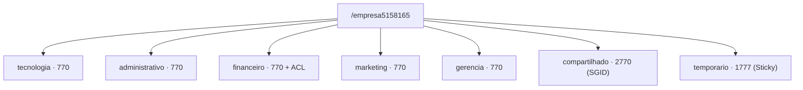

# 🐧 Permissões, Usuários e ACL no Linux — Parte 1


Laboratório da disciplina **Administração de Sistemas Operacionais de Rede I** (Trabalho N1).
Simula uma empresa com 5 departamentos: cada setor acessa só a própria pasta, há uma área compartilhada (SGID), uma área temporária protegida (Sticky Bit) e uma exceção de acesso via ACL.

> Todo recurso leva o RA (`5158165`) no nome.

## 🏗 Arquitetura



| Departamento | Grupo | Usuários |
|---|---|---|
| Tecnologia | `tecnologia5158165` | `tec15158165`, `tec25158165` |
| Administrativo | `administrativo5158165` | `adm15158165`, `adm25158165` |
| Financeiro | `financeiro5158165` | `fin15158165`, `fin25158165` |
| Marketing | `marketing5158165` | `mkt15158165`, `mkt25158165` |
| Gerência | `gerencia5158165` | `ger15158165`, `ger25158165` |

## 🚀 Como executar

Requer Ubuntu/Debian com `sudo` e o pacote `acl`. **Use em VM de laboratório, nunca em produção.**

```bash
sudo apt update && sudo apt install -y acl
git clone https://github.com/<seu-usuario>/<seu-repo>.git
cd <seu-repo>/scripts
chmod +x *.sh
./run-all.sh      # executa tudo em sequência
./cleanup.sh      # remove tudo que foi criado
```

## 🧪 Atividades

| # | Script | O que faz | Resultado esperado |
|---|---|---|---|
| 1 | [`01-criar-grupos.sh`](scripts/01-criar-grupos.sh) | Cria os 5 grupos | `grep 5158165 /etc/group` lista os grupos |
| 2–3 | [`02-criar-usuarios.sh`](scripts/02-criar-usuarios.sh) | Cria 10 usuários, 2 por grupo | `id <usuário>` mostra o grupo primário |
| 4–5 | [`03-estrutura-diretorios.sh`](scripts/03-estrutura-diretorios.sh) | Cria `/empresa5158165` e aplica `chown`/`chmod 770` | `drwxrwx---` em cada setor |
| 6 | [`04-umask.sh`](scripts/04-umask.sh) | Compara umask padrão (`0022`) com `0027` | Arquivo `640`, diretório `750` |
| 7 | [`05-sgid.sh`](scripts/05-sgid.sh) | `chmod 2770` em `compartilhado` | Arquivos novos herdam o grupo `tecnologia` |
| 8 | [`06-sticky-bit.sh`](scripts/06-sticky-bit.sh) | `chmod 1777` em `temporario` | `rm` por outro usuário: *Operation not permitted* |
| 9 | [`07-suid.sh`](scripts/07-suid.sh) | Lista binários com SUID | `passwd`, `sudo`, `chfn` (`-rwsr-xr-x`) |
| 10 | [`08-acl.sh`](scripts/08-acl.sh) | `setfacl` dando `r-x` ao `tec1` no financeiro | `getfacl` mostra `user:tec15158165:r-x` |
| 11 | [`09-auditoria.sh`](scripts/09-auditoria.sh) | Verificação geral | Grupos, permissões e ACL consolidados |

<details>
<summary><b>Ver comandos principais</b></summary>

```bash
# Grupos e usuários
sudo groupadd tecnologia5158165
sudo useradd -m -g tecnologia5158165 -s /bin/bash tec15158165

# Estrutura e permissões
sudo mkdir -p /empresa5158165/{tecnologia5158165,administrativo5158165,financeiro5158165,marketing5158165,gerencia5158165,compartilhado5158165,temporario5158165}
sudo chown root:tecnologia5158165 /empresa5158165/tecnologia5158165
sudo chmod 770 /empresa5158165/tecnologia5158165

# Especiais
sudo chmod 2770 /empresa5158165/compartilhado5158165   # SGID
sudo chmod 1777 /empresa5158165/temporario5158165      # Sticky Bit
find / -perm -4000 -type f 2>/dev/null | head -n 5     # SUID

# ACL
sudo setfacl -m u:tec15158165:r-x /empresa5158165/financeiro5158165
getfacl /empresa5158165/financeiro5158165
```

</details>

## 📚 Conceitos-chave

| Recurso | Octal | Símbolo | Efeito |
|---|---|---|---|
| **SUID** | `4xxx` | `s` no dono | Executa com os privilégios do dono do arquivo (ex.: `passwd` grava em `/etc/shadow`) |
| **SGID** | `2xxx` | `s` no grupo | Em diretórios, novos itens herdam o grupo do diretório |
| **Sticky Bit** | `1xxx` | `t` em outros | Só o dono do arquivo (ou do diretório) pode apagá-lo |
| **ACL** | — | `+` no `ls -l` | Permissões extras por usuário/grupo, sem alterar dono e grupo |
| **umask** | — | — | Define quais permissões são *removidas* na criação (`0027` → arquivos `640`, diretórios `750`) |

## 🖼 Evidências

<!-- Adicione os prints em evidencias/ e referencie assim:  -->

## ✅ Conclusão

A finalidade deste projeto é simular a infraestrutura de controle de acesso e segurança do sistema operacional que no caso foi o Ubuntu server 26.04 aplicada a um cenário corporativo real. É um ambiente de empresa no qual faz a gestão de acessos que é um dos pilares da segurança a informação e o objetivo principal foi demonstrar como um administrador de redes e sistemas gerencia os acessos dos usuários a fim de manter proteção aos dados de quem pode ou não acessa-los que no é caso a confidenciabilidade e integridade dos Dados de cada segmento da empresa. Foram aplicados nesse trabalho:
1- Mapeamento Organizacional: Criação de estrutura departamental 
2-Isolamento de Diretórios: Aplicação de permissões 
3-Padronização de Segurança Preventiva (umask) : impedir que novos documentos nasçam abertos ao público,
4-Trabalho Colaborativo Seguro (SGID): Garantia de herança de grupo em pastas de uso conjunto, permitindo o compartilhamento de arquivos entre membros de um mesmo setor sem falhas de permissão.
5-Proteção Contra Apagamento Indevido (Stricky Bit): Permitindo compartilhamento e troca de arquivos entre funcionários de setores diferentes, mas impedindo que um usuário apague ou altere arquivos que não lhe pertencem.
6-Privilégios (SUID): Mostrar que precisa de privilégios de superusuario. 
7-Flexibilização de acesso(SUID):Concessão de permissões de leitura/execução para um usuário específico fora do seu setor sem mostrar pra toda empresa ou ter que reestruturar os grupos

